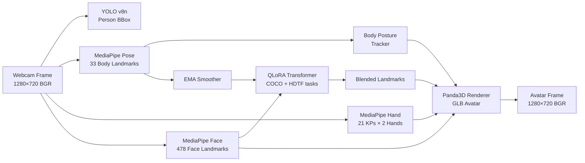

# How the Code Works — Full System Breakdown

## High-Level Data Flow



---

## All 7 Models Used

### Model 1: YOLOv8n — Person Detection
| Property | Value |
|----------|-------|
| **File** | `models/yolo/yolov8n.pt` |
| **Size** | 6.5 MB |
| **Source** | Ultralytics pretrained (COCO class 0 = person) |
| **Used in** | `src/detector/yolo_detector.py` |
| **Purpose** | Detects the primary human subject bounding box for the webcam overlay badge |
| **Inference** | Every frame, `model(frame, conf=0.50)` → picks largest area × confidence box |
| **Training** | NOT trained by this project — pretrained weights only |

### Model 2: MediaPipe PoseLandmarker — 33 Body Keypoints
| Property | Value |
|----------|-------|
| **File** | `models/mediapipe/pose_landmarker_full.task` |
| **Size** | 9.4 MB |
| **Source** | Google MediaPipe Tasks API (auto-downloaded) |
| **Used in** | `src/pose/mediapipe_pose.py` |
| **Purpose** | Extracts 33 3D body landmarks (x, y, z, visibility) + world coordinates in metres |
| **Output** | `[33, 4]` image-space array + `[33, 3]` metric world landmarks |
| **Training** | NOT trained — pretrained Google model |

### Model 3: MediaPipe HandLandmarker — 21 Keypoints × 2 Hands
| Property | Value |
|----------|-------|
| **File** | `models/mediapipe/hand_landmarker.task` |
| **Size** | 7.8 MB |
| **Source** | Google MediaPipe Tasks API (auto-downloaded) |
| **Used in** | `src/pose/mediapipe_pose.py` |
| **Purpose** | 21-keypoint hand tracking for finger articulation (Thumb, Index, Middle, Ring, Pinky × 4 joints each + wrist) |
| **Output** | `[21, 3]` image-space + `[21, 3]` world-space per hand |
| **Training** | NOT trained — pretrained Google model |

### Model 4: MediaPipe FaceLandmarker — 478 Face Landmarks + Blendshapes
| Property | Value |
|----------|-------|
| **File** | `models/mediapipe/face_landmarker.task` |
| **Size** | 3.8 MB |
| **Source** | Google MediaPipe Tasks API |
| **Used in** | `src/pose/facial_expression_engine.py` |
| **Purpose** | Dense facial geometry + ARKit-compatible blendshapes + facial transformation matrix + iris tracking |
| **Output** | ~52 blendshapes (jawOpen, eyeBlink, mouthSmile, etc.) + 4×4 pose matrix + gaze vectors |
| **Training** | NOT trained — pretrained Google model |

### Model 5: GLB Avatar — Skinned 3D Character
| Property | Value |
|----------|-------|
| **File** | `models/avatars/rpm_fullbody.glb` |
| **Size** | 13.8 MB |
| **Source** | Ready Player Me (RPM) full-body avatar export |
| **Used in** | `src/animator/gltf_asset.py` → `src/animator/native_avatar_renderer.py` |
| **Contains** | 68 bones (skeleton), skinned mesh, morph targets (ARKit blendshapes for face) |
| **Bones** | Hips → Spine → Spine1 → Spine2 → Neck → Head, Left/RightArm → ForeArm → Hand → 5 fingers × 4 segments, Left/RightUpLeg → Leg → Foot → ToeBase |

### Model 6: Idle Standing Animation
| Property | Value |
|----------|-------|
| **File** | `models/avatars/idle_standing.glb` |
| **Size** | 168 KB |
| **Used in** | `src/animator/gltf_asset.py` — merged into the avatar at load time |
| **Purpose** | Provides a looping idle breathing/standing animation as the base pose. Every frame, joints are reset to this animation before tracking overrides are applied. |

### Model 7: Unified Multi-Task QLoRA Transformer — THE TRAINED MODEL
| Property | Value |
|----------|-------|
| **File** | `models/qlora_pose/unified_multitask_qlora.pt` |
| **Size** | 17.2 MB |
| **Source** | Trained by `train_all.py` |
| **Used in** | `src/pipeline.py` lines 58-72 |
| **Architecture** | See detailed breakdown below |

---

## QLoRA Transformer — Deep Dive

### Architecture

```
UnifiedMultiTaskTransformer
├── Image Encoder (CNN)          ← shared, FROZEN
│   Conv2d(3→64, 7×7, stride 2) → BN → GELU → MaxPool
│   Conv2d(64→256, 3×3, stride 2) → BN → GELU
│   Output: [B, 256, h, w] → flattened to [B, L, 256]
│
├── MoCap Encoder                ← shared, FROZEN
│   Linear(93 → 256)
│
├── Landmark Encoder             ← shared, FROZEN
│   Linear(3 → 256)
│
├── Positional Embedding         ← shared, FROZEN
│   [1, 512, 256] learnable
│
├── 4× Transformer Encoder Layers  ← base weights FROZEN
│   Each layer:
│   ├── MultiheadAttention(256, 8 heads)  ← FROZEN
│   ├── LayerNorm × 2                     ← FROZEN
│   ├── FFN Linear 1 (256→1024)           ← base FROZEN + LoRA A/B per task
│   └── FFN Linear 2 (1024→256)           ← base FROZEN + LoRA A/B per task
│
└── 4× Task Output Heads         ← each trained with its task
    ├── coco:  Linear(256→128) → GELU → Linear(128→51)  → reshape [17, 3]
    ├── mocap: Linear(256→128) → GELU → Linear(128→93)  → reshape [31, 3]
    ├── hdtf:  Linear(256→128) → GELU → Linear(128→4)
    └── faces: Linear(256→128) → GELU → Linear(128→25)
```

### How Many Checkpoints?

**1 single checkpoint file** containing everything:

```python
# Saved by train_all.py line 208-218
torch.save({
    "model_state_dict": model.state_dict(),   # ALL weights in one dict
    "tasks_trained": ["coco", "mocap", "hdtf", "faces"],
    "task_losses": {...},
    "epochs": 10,
    "embed_dim": 256, "num_heads": 8, "num_layers": 4,
    "lora_r": 16, "lora_alpha": 32,
})
```

Inside that single `model_state_dict`, the LoRA adapters for all 4 tasks coexist:

| Component | Keys in state_dict | Trainable? |
|-----------|-------------------|------------|
| Image encoder CNN | `image_encoder.*` | ❌ Frozen |
| MoCap encoder | `mocap_encoder.*` | ❌ Frozen |
| Landmark encoder | `landmark_encoder.*` | ❌ Frozen |
| Positional embedding | `pos_embed` | ❌ Frozen |
| Transformer base weights | `transformer_layers.*.ff1.weight`, `.ff2.weight` | ❌ Frozen |
| Transformer attention | `transformer_layers.*.self_attn.*` | ❌ Frozen |
| **COCO LoRA adapters** | `transformer_layers.*.ff1.lora_A.coco`, `.lora_B.coco`, `.ff2.lora_A.coco`, `.lora_B.coco` | ✅ Trained |
| **MoCap LoRA adapters** | `transformer_layers.*.ff1.lora_A.mocap`, `.lora_B.mocap`, etc. | ✅ Trained |
| **HDTF LoRA adapters** | `transformer_layers.*.ff1.lora_A.hdtf`, `.lora_B.hdtf`, etc. | ✅ Trained |
| **Faces LoRA adapters** | `transformer_layers.*.ff1.lora_A.faces`, `.lora_B.faces`, etc. | ✅ Trained |
| COCO head | `task_heads.coco.*` | ✅ Trained |
| MoCap head | `task_heads.mocap.*` | ✅ Trained |
| HDTF head | `task_heads.hdtf.*` | ✅ Trained |
| Faces head | `task_heads.faces.*` | ✅ Trained |

### LoRA Per-Layer Breakdown

Each of the 4 transformer layers has 2 FFN linears. Each FFN linear has 4 task LoRA pairs:

```
Per FFN Linear: 4 tasks × (A matrix [16, in] + B matrix [out, 16])
Per Transformer Layer: 2 FFN linears × 4 tasks = 8 LoRA pairs
Total: 4 layers × 8 pairs = 32 LoRA A/B matrix pairs
```

With `r=16`, `alpha=32` → scaling factor = `alpha/r = 2.0`

### Which Tasks Are Actually Used at Runtime?

Only **2 out of 4** tasks are used during live inference:

| Task | Used at Runtime? | How |
|------|-----------------|-----|
| **coco** | ✅ Yes | Every 3rd frame, image → 17 COCO keypoints → blended with MediaPipe to fill occluded joints (`src/pipeline.py` L111-129) |
| **hdtf** | ✅ Yes | Every frame when face detected, 11 face landmarks → 4 talking-head params (mouth_open, lip_stretch, blink, head_roll) (`src/pipeline.py` L131-146) |
| **mocap** | ❌ No | Trained but not used at inference — was for 3D motion forecasting from CMU MoCap sequences |
| **faces** | ❌ No | Trained but not used at inference — was for camera pose regression from synthetic face images |

---

## Per-Frame Pipeline Walkthrough

Here's exactly what happens when `process_frame()` (`src/pipeline.py`) is called:

### Step 1: Input Processing
```
frame (1280×720 BGR) → resize if needed → mirror if MIRROR_WEBCAM=True
```

### Step 2: YOLO Detection
```
frame → YOLOv8n → best person bounding box (for overlay only, not used for tracking)
```

### Step 3: MediaPipe Body + Hands
```
frame → PoseLandmarker → [33, 4] landmarks + [33, 3] world landmarks
frame → HandLandmarker → [21, 3] per hand (left + right) + world coords
```

### Step 4: Body Posture Classification
```
landmarks + world → BodyPostureTracker → {state: "standing"/"sitting"/"unknown",
                                           coverage: "portrait"/"waist"/"knees"/"full",
                                           leg_directions: {...},
                                           torso_direction: [...],
                                           hip_direction: [...]}
```

### Step 5: Smoothing
```
landmarks → EMA Smoother (alpha=0.60) → smoothed landmarks
```

### Step 6: QLoRA COCO Task (every 3rd frame)
```
frame → resize 256×256 → ImageNet normalize → image_encoder → transformer(task="coco")
→ [17, 3] COCO keypoints → blend with MediaPipe (12% weight when MP confident, 45% when uncertain)
```

### Step 7: FaceLandmarker + QLoRA HDTF Task
```
frame → FaceLandmarker → 478 landmarks + blendshapes + pose matrix
11 key landmarks → landmark_encoder → transformer(task="hdtf") → [4] predictions
→ blended 65% MediaPipe + 35% QLoRA for mouth/lip/blink/roll
```

### Step 8: Panda3D Avatar Rendering
```
For each frame:
  1. Reset all 68 joints to idle animation pose
  2. _update_posture() → hips rotation, spine chain, leg bones from body_tracking
  3. _update_body() → arm bones from landmarks, two-bone IK from hand wrists
  4. _update_hands() → palm orientation + 15 finger segments per hand
  5. _update_face() → blendshape sliders + head/neck rotation from pose matrix
  6. Blend all joints with previous frame (EMA, tau=65ms)
  7. _ground_body() → adjust root so feet touch floor
  8. _update_camera() → dynamic zoom based on coverage
  9. Render → GPU offscreen buffer → read back as BGR numpy array
```

### Step 9: Output
```
camera_preview (webcam + YOLO overlay) | avatar_preview (Panda3D render + status bar)
+ telemetry dict with all tracking data
```

---

## Weight Files Summary

| File | Size | Source | Trained by Project? |
|------|------|--------|-------------------|
| `yolov8n.pt` | 6.5 MB | Ultralytics pretrained | ❌ |
| `pose_landmarker_full.task` | 9.4 MB | Google MediaPipe | ❌ |
| `hand_landmarker.task` | 7.8 MB | Google MediaPipe | ❌ |
| `face_landmarker.task` | 3.8 MB | Google MediaPipe | ❌ |
| `rpm_fullbody.glb` | 13.8 MB | Ready Player Me | ❌ (3D asset) |
| `idle_standing.glb` | 168 KB | Animation asset | ❌ (3D asset) |
| **`unified_multitask_qlora.pt`** | **17.2 MB** | **`train_all.py`** | **✅ Yes** |

> **Only 1 checkpoint is trained and used**: `unified_multitask_qlora.pt`. It's a single file containing the entire model with all 4 task LoRA adapters, but only **coco** and **hdtf** tasks are actually invoked during live avatar rendering. The **mocap** and **faces** tasks are trained but sit unused at runtime.
